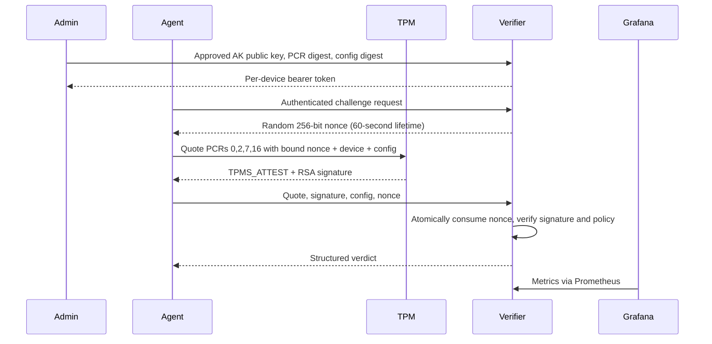

# Linux TPM Attestation & Device Integrity Monitor

A working TPM 2.0 attestation lab: a Linux Python agent obtains signed quotes,
a remote FastAPI verifier checks them against administrator-approved baselines,
and Prometheus/Grafana expose accepted, rejected, and stale device reports.

The default demo uses **swtpm**, not a physical hardware root of trust. It runs on
Linux and through Docker's Linux VM on macOS. It does not attest the macOS host.

## Run the complete demo

Prerequisites: Docker Engine/Desktop with Compose, Python 3 for local secret generation.

```sh
sh scripts/init-env.sh
docker compose build
docker compose up -d verifier prometheus grafana
docker compose run --rm test
docker compose run --rm demo
```

The demo provisions a new software TPM and restricted RSA attestation key,
explicitly enrolls its public key and baseline, and asserts these outcomes:

| Scenario | Expected decision |
|---|---|
| Fresh approved quote | verified |
| Identical quote submitted twice | nonce_expired_or_replayed |
| Altered signature | signature_invalid |
| Changed configuration file | config_drift |
| Restored configuration | verified |
| PCR16 extended with a new measurement | pcr_drift |

The demo then sends three more reports, five seconds apart, exercising periodic monitoring.
Each invocation creates a separate device identity. The test container has its own
TPM and SQLite database; it never changes the running verifier's enrollment.

Open [Grafana](http://localhost:3001/d/tpm-integrity), user `admin`; find the generated
password in your local `.env`. [Prometheus](http://localhost:9090) collects metrics
and [API docs](http://localhost:8000/docs) describe the verifier. All published
ports bind to localhost. Secrets, TPM contexts, and databases are excluded from Git.

Stop with `docker compose down`. The verifier database remains in its volume.
`docker compose down -v` deliberately deletes enrollments and event history.

## Architecture and protocol



Only RSA PKCS#1 v1.5/SHA256 quotes and the SHA256 bank with PCRs 0,2,7,16
are supported. The verifier strictly parses the signed TPMS_ATTEST, including
magic, quote type, safe-clock flag, exact bank/selection, nonce binding, and digest.
It compares the signed PCR aggregate with SHA256 of the four approved PCR values
in selection order. No client-supplied "verified" flag is trusted.

The qualification field is SHA256 of a domain separator and canonical JSON
containing the server nonce, device ID, and collected configuration. This binds
the report to the quote and prevents in-transit configuration substitution.
The configuration values are still **agent assertions**, not independently
measured by firmware or a kernel integrity subsystem.

Enrollment requires a separate admin bearer token. Per-device tokens are random,
stored only as SHA256 hashes, and limited to that device's challenge and evidence
endpoints. Enrollment cannot overwrite an existing identity. Revocation disables
the identity and removes its pending challenge. Re-enrollment uses a new device ID.
Baseline updates require a reviewed new enrollment; drift never auto-approves itself.

SQLite persists enrollments, challenges, and structured events across restarts.
A write transaction serializes challenge consumption and decisions, including
concurrent replay attempts. A new challenge invalidates the previous one for that
device. A failed submission with the current nonce consumes it too.

## Physical Linux TPM

Install `tpm2-tools` and Python 3.11+, create a virtual environment, and install
`pip install -e '.[test]'`. Use `TPM2TOOLS_TCTI=device:/dev/tpmrm0` and grant only the
agent account access to that device. Inspect `tpm2_getcap properties-fixed` and
`tpm2_getcap handles-persistent` before choosing unused persistent handles.
Do not run the simulator provisioning script against real hardware.

Under controlled provisioning, create an EK and restricted AK with
`tpm2_createek` / `tpm2_createak`, persist the AK using `tpm2_evictcontrol`, and
export its PEM public key. Handle values and hierarchy authorization depend on
your machine; never evict existing platform keys to make this example fit.
Generate the baseline **only on a separately approved, known-good platform**:

```sh
integrity-agent baseline --device server-01 --pem state/ak.pem \
  --file /etc/ssh/sshd_config > state/enrollment.json
```

Transfer this baseline to the administrator over a trusted channel and submit it
with the admin credential to `POST /v1/enroll`. Securely install the returned token
in the agent's environment, then run:

```sh
integrity-agent watch --device server-01 --ak 0x81010002 \
  --url https://verifier.example --file /etc/ssh/sshd_config --interval 30
```

Set `DEVICE_TOKEN` from a protected service credential, not a command-line argument.
The client validates HTTPS certificates by default. Terminate TLS at a trusted
reverse proxy for remote use. The Compose HTTP configuration is a localhost lab.
The collector reports EFI Secure Boot as enabled, disabled, or unknown; containers
usually report unknown. Secure Boot is not claimed merely because a quote verifies.

## Tests and operational limits

`docker compose run --rm test` runs unit/API tests and a real swtpm integration
case, including independent validation with upstream `tpm2_checkquote`. Running
`pytest` outside the simulator skips the physical-tool integration test explicitly.
See [threat model](docs/THREAT_MODEL.md), [operations](docs/OPERATIONS.md), and
[validation record](docs/VALIDATION.md).

This is a security engineering prototype, not an audited production attestation
service. It intentionally omits EK certificate validation/credential activation,
measured-boot event log replay, IMA integration, fleet-scale storage, and automatic
remediation. A trusted enrollment operator must authenticate each AK out of band.

## References

- [tpm2_quote](https://tpm2-tools.readthedocs.io/en/latest/man/tpm2_quote.1/)
- [tpm2_checkquote](https://tpm2-tools.readthedocs.io/en/latest/man/tpm2_checkquote.1/)
- [swtpm](https://github.com/stefanberger/swtpm)
