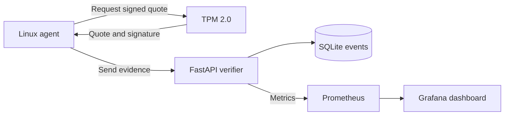

# TPM Integrity Monitor

**Check device integrity. Catch drift. Reject replay.**

A Linux agent collects TPM quotes. A remote verifier checks the signature and approved baseline. Grafana shows the results.

[](https://github.com/hranjan004/tpm-integrity-monitor/actions/workflows/test.yml)



## Try it

You need Docker with Compose and Python 3. The demo runs on Linux or macOS through Docker's Linux VM.

```sh
git clone https://github.com/hranjan004/tpm-integrity-monitor.git
cd tpm-integrity-monitor
sh scripts/init-env.sh
docker compose build
docker compose up -d verifier prometheus grafana
docker compose run --rm test
docker compose run --rm demo
```

Open [the dashboard](http://localhost:3001/d/tpm-integrity). Username: `admin`. Your generated password is the `GRAFANA_PASSWORD` entry in `.env`.

Also available: [API docs](http://localhost:8000/docs) · [Prometheus](http://localhost:9090).

The demo uses **swtpm**, a software TPM. Its measurements describe the simulator. They do not attest your host's boot state.

## What you will see

```mermaid
flowchart LR
    Start[Run demo] --> Healthy[Approved quote: accepted]
    Healthy --> Replay[Reuse quote: rejected]
    Replay --> Tamper[Change signature: rejected]
    Tamper --> Config[Change config: rejected]
    Config --> Restore[Restore config: accepted]
    Restore --> PCR[Extend PCR16: rejected]
    PCR --> Watch[Three more drift reports]
```



Every run creates a fresh demo device. Each scenario checks the verifier's response. The test container has separate TPM and database state.

## How it works

1. An administrator approves a device key and baseline.
2. The verifier issues a random, single-use challenge.
3. The agent asks the TPM to sign its measurements and a binding to the report.
4. The verifier checks freshness, signature, PCR selection, and baseline.
5. It stores a verdict. Prometheus collects it. Grafana plots it.

Read the [visual walkthrough](docs/VISUAL_GUIDE.md) for the full protocol, quote layout, decision flow, dashboard panels, and device lifecycle.

## Tools used

| Tool | Job |
|---|---|
| TPM 2.0 / swtpm | Hold the attestation key and sign PCR quotes |
| tpm2-tools | Provision keys, read PCRs, generate and cross-check quotes |
| Python | Collect file hashes and run the agent |
| FastAPI + Uvicorn | Serve enrollment, challenges, and verification |
| cryptography | Check RSA signatures |
| Pydantic | Validate request fields |
| HTTPX | Send agent requests |
| SQLite | Store devices, pending challenges, and verdicts |
| Prometheus | Collect metrics and evaluate alert rules |
| Grafana | Display verdicts and report freshness |
| Docker Compose | Run the local stack |
| pytest + GitHub Actions | Test the protocol and simulator on Linux |

Version pins live in [pyproject.toml](pyproject.toml), [requirements.lock](requirements.lock), and [compose.yaml](compose.yaml). See [sources and references](SOURCES.md) for the documentation behind each part.

## Use it beyond the demo

- [Usage guide](docs/USAGE.md): start, test, inspect results, stop, and reset.
- [Hardware setup](docs/HARDWARE.md): connect a physical Linux TPM.
- [Operations](docs/OPERATIONS.md): credentials, monitoring, and troubleshooting.
- [Threat model](docs/THREAT_MODEL.md): what a passing quote proves.
- [Validation](docs/VALIDATION.md): what was actually tested.

## Limits

This is a working security lab. Physical TPM testing remains outstanding. Enrollment trusts the operator to authenticate the key. File hashes are agent reports, even though the quote binds them. The project does not verify EK certificates or replay measured-boot event logs.

The default services bind to localhost. Use TLS and controlled provisioning for remote deployments. A matching PCR baseline is evidence about selected measurements, not a guarantee that the whole machine is safe.
