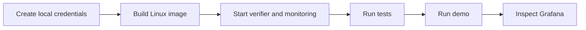

# Use the project

## Start the lab

From the repository directory:

```sh
sh scripts/init-env.sh
docker compose build
docker compose up -d verifier prometheus grafana
```

The setup script creates `.env` once. It holds local administrator and Grafana credentials. It is ignored by Git. Running the script again keeps your existing credentials.



## Run tests and the demo

```sh
docker compose run --rm test
docker compose run --rm demo
```

The tests include a real software TPM. A successful test run has no skipped TPM tests. Outside the simulator, pytest explicitly skips the integration case.

The demo prints JSON for each scenario. Look at `scenario`, `accepted`, and `reason`. It intentionally produces failures to demonstrate detection. Every scenario asserts the expected result.

## Open the services

| Service | Address | Login |
|---|---|---|
| Grafana | http://localhost:3001/d/tpm-integrity | `admin`, password from `.env` |
| API explorer | http://localhost:8000/docs | Protected endpoints require a bearer token |
| Prometheus | http://localhost:9090 | Local demo has no login |

The Grafana password belongs to this local installation. It is not published in this repository. If another service uses a listed port, change its host-side mapping in `compose.yaml`.

## Inspect results

```sh
docker compose ps
docker compose logs --tail=30 verifier
curl http://localhost:8000/healthz
curl http://localhost:8000/metrics
```

`GET /v1/events` returns the latest 100 verdicts with administrator authentication. In the API explorer, provide `Bearer <your ADMIN_TOKEN>` in the endpoint's `authorization` header. Use your local secret; do not paste it into an issue or commit.

## Collect from your own Linux device

Follow [hardware setup](HARDWARE.md) first. After reviewed enrollment, configure `DEVICE_TOKEN` in the agent's protected environment.

```sh
integrity-agent once --device server-01 --ak 0x81010002 \
  --url https://verifier.example --file /etc/ssh/sshd_config

integrity-agent watch --device server-01 --ak 0x81010002 \
  --url https://verifier.example --file /etc/ssh/sshd_config --interval 30
```

`once` exits `0` on acceptance, `2` on rejection, or `1` on collection/transport failure. `watch` repeats at the chosen interval. Add another `--file` for each file to track. Use the actual provisioned AK handle on your device.

## Stop or reset

```sh
docker compose down
```

This keeps the verifier's database volume. To deliberately delete all enrollments and event history:

```sh
docker compose down -v
```

Grafana and Prometheus history are disposable in this lab. Keep `.env` if you want the same local credentials next time.
