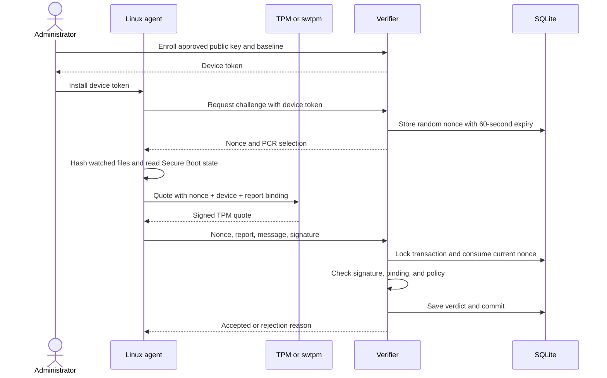
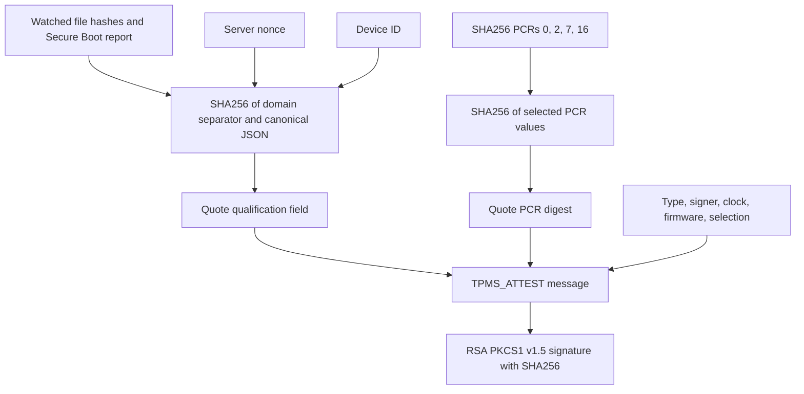
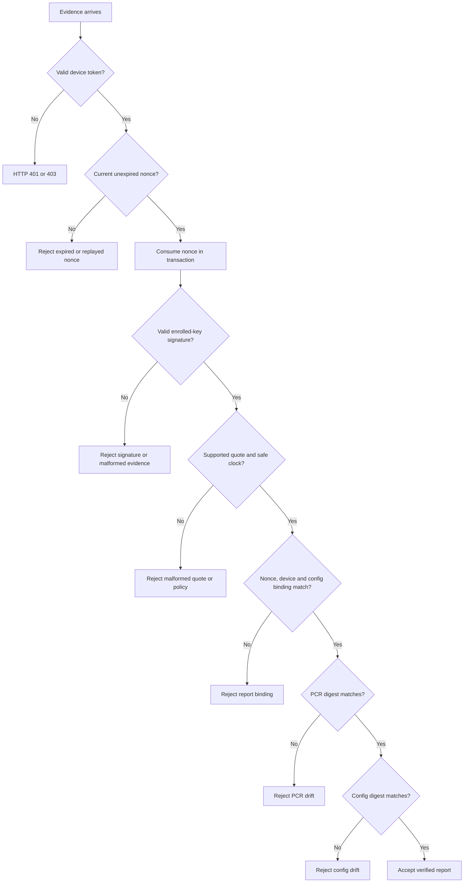
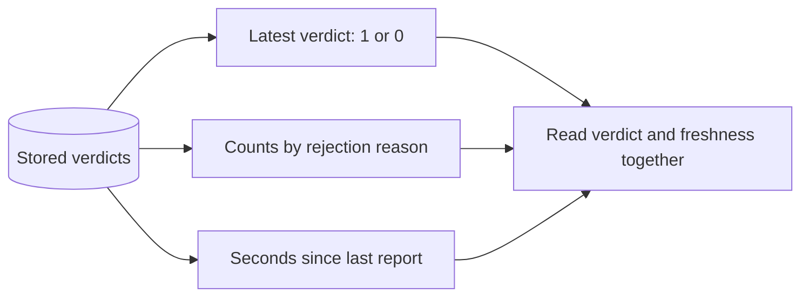
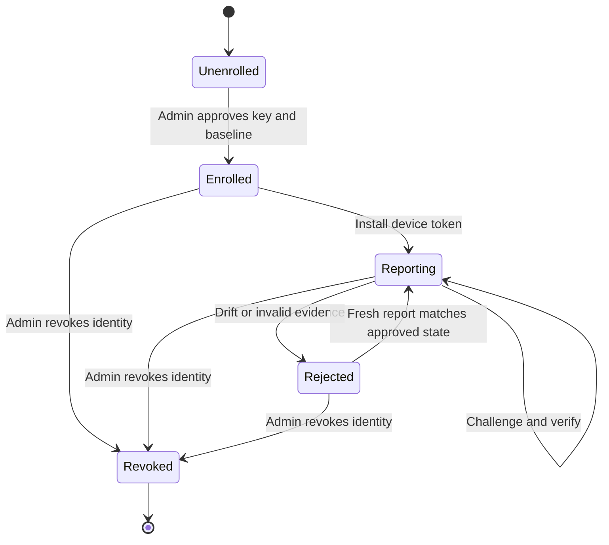
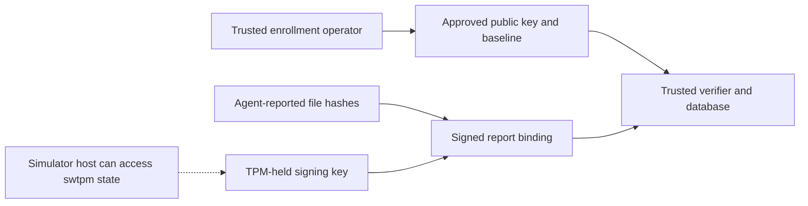

# A tour of the system

## 1. Know the terms

| Term | Meaning here |
|---|---|
| TPM | The component that holds the signing key and PCR measurements |
| AK | Attestation key; its public half is pinned during enrollment |
| PCR | A register that accumulates measurements through hashing |
| Quote | A signed TPM message containing selected PCR information |
| Nonce | A fresh random challenge that can be used once |
| Baseline | Measurements the administrator has approved |
| Drift | A measurement no longer matches that baseline |

## 2. Follow one report

A new challenge replaces the previous one for that device. A failed submission with the current nonce consumes it too. Database transactions prevent two workers from accepting the same challenge.

## 3. Look inside the quote

The supported profile uses one SHA256 bank and exactly PCRs 0, 2, 7, and 16. The verifier checks the bank and selection explicitly. It compares the signed PCR digest with the approved aggregate.

The report binding prevents changing reported configuration after signing. It does not prove that a compromised agent reported the real file contents.

## 4. See why a report passes or fails

API shape validation can return HTTP 422 before evidence processing. The diagram shows the path for a structurally valid request. A malformed signature or quote never produces acceptance.

## 5. Read the dashboard

| Panel | What to look for |
|---|---|
| Latest attestation verdict | `1` means the last submitted report passed; `0` means it failed |
| Attestations by result | Which reasons are increasing, and on which device |
| Seconds since last report | Whether a device has stopped reporting |

The demo ends with intentional PCR drift. A failed verdict at its end is expected. Later, its report age increases because the demo has stopped. Alert rules flag rejection, reports older than 120 seconds, and verifier outages. No notification destination is configured.

## 6. Follow the device lifecycle

Revocation disables authentication and removes the pending challenge. History stays in SQLite. An existing enrollment cannot be overwritten. Rotation and baseline changes use a new reviewed device identity.

## 7. Understand the trust boundary

The software TPM is suitable for testing the protocol. Its host can access its state. A physical TPM adds isolation, but trusted enrollment and honest measurement collection still matter. See the [threat model](THREAT_MODEL.md) for the remaining assumptions.

## 8. Find the code

| File | Responsibility |
|---|---|
| `integrity/agent.py` | Collect files, request quotes, submit reports, repeat |
| `integrity/crypto.py` | Parse the quote and verify its signature and binding |
| `integrity/verifier.py` | Authenticate, enroll, consume nonces, store results |
| `scripts/simulator.sh` | Start swtpm and provision the demo key |
| `scripts/demo.py` | Run the attack and recovery scenarios |
| `tests/test_tpm.py` | Exercise actual tpm2-tools commands against swtpm |
| `tests/test_verifier.py` | Exercise API, parser, policy, and replay cases |
| `monitoring/` | Configure metrics, alert rules, and dashboards |
